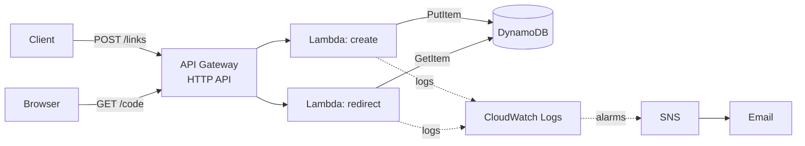

# Serverless URL Shortener

A URL shortener built on AWS serverless services and managed entirely with Terraform. It supports auto-generated short codes, custom aliases, 302 redirects, structured logging, least-privilege IAM, and alerting.

## Architecture



**How it works:** `POST /links` validates the URL, picks a code (custom or random), and stores `code -> URL` in DynamoDB. `GET /{code}` looks the code up and replies with a `302` and a `Location` header. The browser follows it, so the service never serves the destination page itself.

| Component | Role |
|---|---|
| API Gateway (HTTP API) | Public entry point. Routes requests and throttles traffic |
| Lambda `create` | Validates input, generates codes, writes links |
| Lambda `redirect` | Validates the code, reads the link, returns the redirect |
| DynamoDB | Stores `shortCode -> longUrl`. On-demand billing, point-in-time recovery, deletion protection |
| IAM | One role per function, each limited to a single DynamoDB action on this table |
| CloudWatch | Structured JSON logs (7-day retention) and alarms |
| SNS | Emails alarm notifications |

## API

### `POST /links`: create a short link

Request body:
```json
{ "url": "https://example.com/some/long/page", "alias": "my-link" }
```
`alias` is optional.

Success: `201 Created`
```json
{ "shortCode": "my-link", "shortUrl": "https://<api-domain>/my-link" }
```

| Status | When | Body |
|---|---|---|
| 400 | Body is not valid JSON | `{"error":"Invalid request body"}` |
| 400 | `url` missing, invalid, or not http/https | `{"error":"Invalid URL"}` |
| 400 | `alias` breaks the alias rules or is reserved | `{"error":"Invalid alias"}` |
| 409 | `alias` already taken | `{"error":"Alias already in use"}` |
| 500 | Unexpected failure | `{"error":"Internal server error"}` |

### `GET /{code}`: redirect to the original URL

| Name | Description |
|---|---|
| `code` | The short code or custom alias, e.g. `abc123` or `my-link` |

Success: `302 Found` with `Location: <original url>` and an empty body.

| Status | When | Body |
|---|---|---|
| 400 | `code` breaks the alias rules | `{"error":"Invalid code"}` |
| 404 | No link exists for this `code` | `{"error":"Link not found"}` |
| 500 | Unexpected failure | `{"error":"Internal server error"}` |

## Design decisions

**Alias rules**
- Allowed characters: lowercase letters, numbers, hyphen. Safe inside a URL.
- Length: 3 to 30 characters. Blocks junk and storage abuse.
- Case-insensitive: aliases are lowercased before saving, so `Promo` and `promo` are the same link.

**Reserved words:** `links`, `admin`, `api`, `health`. Avoids clashes with future routes.

**Generated codes:** 7 characters from `a-z 0-9` (about 78 billion combinations), created with a cryptographically secure random source.

**Collisions:** writes use a DynamoDB conditional write (`attribute_not_exists(shortCode)`), so checking and writing is one atomic step. A custom alias that exists returns `409`. A generated code that collides is retried up to 3 times, then returns `500`.

**302, not 301:** browsers cache a 301 permanently, which would make links impossible to change or track later.

**Least privilege:** `create` can only `PutItem`. `redirect` can only `GetItem`. Both are scoped to the one table.

**Error handling:** input is validated before any database call. Real errors go to CloudWatch, and clients receive only a generic message so internals don't leak.

**Throttling:** the API stage caps traffic at 10 requests per second (burst 20) as basic abuse protection.

## Project structure

```
.
├── src/
│   ├── create/index.mjs       Lambda: create links
│   └── redirect/index.mjs     Lambda: redirect
├── infra/                     Terraform, one resource per file
│   ├── dynamodb.tf, iam-*.tf, lambda-*.tf, api-*.tf
│   ├── logs-*.tf, sns.tf, alarms-*.tf
│   └── variables.tf, outputs.tf
└── .github/workflows/         CI: terraform fmt and validate
```

## Deploy

**Prerequisites:** Terraform 1.6+, AWS CLI configured (`aws sts get-caller-identity` should print your identity), Node.js 22 runtime available in your target region.

```bash
cd infra

# Set the email that receives alarm notifications
echo 'alarm_email = "you@example.com"' > terraform.tfvars

terraform init
terraform plan      # review what will be created
terraform apply     # type "yes" to confirm
```

AWS emails a confirmation link to the alarm address. **Click it**, or alarms can't reach you.

Get the API URL:
```bash
terraform output -raw api_url
```

## Try it

```bash
API=$(terraform output -raw api_url)

# Create a link with a custom alias
curl -i -X POST $API/links \
  -H "Content-Type: application/json" \
  -d '{"url":"https://example.com/page","alias":"demo-link"}'

# Follow it (no -L, so you can see the 302)
curl -i $API/demo-link

# Create a link with a generated code
curl -i -X POST $API/links \
  -H "Content-Type: application/json" \
  -d '{"url":"https://example.com/other"}'

# Error cases
curl -i $API/does-not-exist                                     # 404
curl -i -X POST $API/links -H "Content-Type: application/json" \
  -d '{"url":"ftp://example.com"}'                              # 400
```

## Observability

Logs are structured JSON, so they can be queried in CloudWatch Logs Insights:

```
fields @timestamp, event, code
| filter event = "not_found"
| sort @timestamp desc
| limit 20
```

Events logged: `created`, `redirect`, `not_found`, `invalid_code`, `collision`, `error`.

Alarms (all notify via SNS): Lambda `Errors` for each function, plus API Gateway `5xx`. The `5xx` alarm exists because the code returns handled `500` responses, which Lambda's own `Errors` metric doesn't count.

## Cost

Every component is pay-per-use with no idle charge, so an unused deployment costs almost nothing. Log retention is set to 7 days to keep storage from growing.

## Tear down

The table has deletion protection on. To remove everything:

1. Set `deletion_protection_enabled = false` in `infra/dynamodb.tf`.
2. Run `terraform apply`.
3. Run `terraform destroy`.

## CI

A GitHub Actions workflow runs `terraform fmt -check` and `terraform validate` on every push and pull request that touches `infra/`. It needs no AWS credentials.

## Possible next steps

- Custom domain, so a future cutover is a DNS change
- Remote Terraform state in S3 with locking
- Click counts per link
- Link expiry using DynamoDB TTL
- `terraform plan` in CI using OIDC instead of stored keys